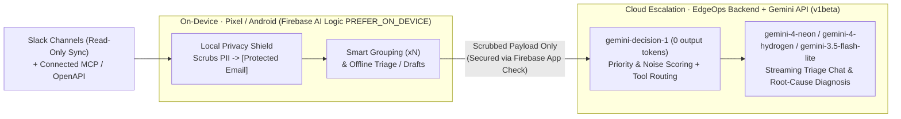

# CalmDuty — Android On-Call Companion (`calmduty.com` · Kotlin + Jetpack Compose)

> **Calm triage, while your agents make noise.** Built with **Firebase AI Logic Hybrid Inference** (`PREFER_ON_DEVICE` · Gemini Nano), **Firebase App Check**, **Gemini Decisions API (`gemini-decision-1` · 0 output tokens)**, and **Gemini Dynamic Tool Retrieval**.

CalmDuty pairs a **Web Command Desk & Landing Page** ([`Timtech4u/edgeops`](https://github.com/Timtech4u/edgeops)) with this **native Android companion** (`100% Kotlin` + `Jetpack Compose` + `Material 3`) sharing one **Firebase** project (`Cloud Firestore`, `Firebase Auth`, `Firebase App Check`, `Firebase AI Logic`) and one **Cloud Run** backend.

### Download & Install
- **Direct APK (No Play Store needed):** Download `calmduty-v0.1.0-android.apk` from [**GitHub Releases**](https://github.com/Timtech4u/edgeops-android/releases/latest)
- **Step-by-step Install & Self-Host Guide:** Read [`docs/INSTALL_APK.md`](./docs/INSTALL_APK.md)

---

## Why Hybrid AI?

Operations teams cannot blindly send raw customer tickets, emails, phone numbers, and thousands of noisy alerts straight to a cloud LLM—it leaks PII and wastes tokens.



---

## Key Features

- **On-Device Privacy Shield (`PREFER_ON_DEVICE` · Gemini Nano):** Cleans raw Slack markup and redacts emails, phone numbers, account IDs, and tokens locally into `[Protected Email]` / `[Protected Phone]` / `[Protected Account]` *before* any cloud call, with a tap-to-inspect Before/After diff.
- **Zero-Output-Token Priority & Noise Triage (`gemini-decision-1`):** Calibrated parallel `noul` probabilities (`Needs action`, `Revenue / SLA risk`, `Engineering needed`, `Routine FYI`) pin urgent fires (`Urgent · 99%`) to the top of **Needs Action** and auto-collapse routine confirmations into **Hidden Noise**—at `0` output tokens.
- **Smart Duplicate Grouping (`×N`):** Collapses repeated operational alerts into single threads with occurrence counts.
- **Ultra-Fast Streaming Triage Chat:** Inline streaming chat powered by **Firebase AI Logic Hybrid Inference** (`PREFER_ON_DEVICE` → streaming `gemini-3.5-flash-lite`) with 1-click prompt chips (**Explain & next step**, **Draft customer reply**, **Summarize all ×N alerts**) and offline fallback.
- **Zero Raw PII in Cloud Firestore & Auto-Backup Disabled:** Raw unredacted messages stay strictly in an on-device memory vault (`EdgeOpsRepository`) for the local Before/After Privacy Diff and are **never written to Cloud Firestore** (enforced by `firestore.rules`). `android:allowBackup="false"` and explicit backup exclusion rules prevent Google Drive backups of local operational data.
- **Global Proactive Copilot FAB & Native Android Notifications:** Watches all channels, surfaces proactive briefings for urgent (`90%+`) fires and `×2+` spikes, streams workspace-wide answers via Firebase AI Logic (`PREFER_ON_DEVICE`), and triggers native `POST_NOTIFICATIONS` (`edgeops_urgent_alerts` high-importance channel).
- **Vendor-Agnostic Dynamic Tool Retrieval:** Connect any Slack workspace via 1-click read-only OAuth, plus bring-your-own **Remote MCP Servers** and **OpenAPI JSON** specs—sent as full deferred tool schemas to `/api/investigate` for `gemini-decision-1` tool routing + `gemini-4-neon` diagnosis.
- **Secured with Firebase App Check:** Enforced on all Firebase AI Logic and Firestore operations (supports debug tokens for local development & judging).

---

## Tech Stack

| Layer | Technology |
| :--- | :--- |
| **UI & App** | Kotlin, Jetpack Compose, Material 3 (Light Mode), Navigation Compose |
| **Hybrid On-Device AI** | Firebase AI Logic Android SDK (`firebase-ai` + `firebase-ai-ondevice`, `InferenceMode.PREFER_ON_DEVICE`) |
| **Cloud Models** | `gemini-decision-1` (0 output tokens), `gemini-3.5-flash-lite` (streaming chat), `gemini-4-hydrogen` / `gemini-4-neon` (deep diagnosis) |
| **Security & Sync** | Firebase App Check, Firebase Auth (Credential Manager / Google Sign-In), Cloud Firestore (offline persistence enabled) |
| **Shared Backend** | EdgeOps Web & API on Google Cloud Run ([`Timtech4u/edgeops`](https://github.com/Timtech4u/edgeops)) |

---

## Project Structure

```text
app/src/main/java/com/example/
├── MainActivity.kt                  # App Check init, Google Sign-In, NavHost
├── ai/
│   ├── HybridAiService.kt           # Firebase AI Logic (PREFER_ON_DEVICE) + streaming triage chat
│   └── LocalPrivacyShield.kt        # Local PII scrubbing & Slack mrkdwn cleanup
├── data/
│   ├── CloudRunInvestigatorClient.kt# Live Cloud Run /api/slack/* & /api/investigate client
│   ├── EdgeOpsRepository.kt         # Cloud Firestore sync & offline persistence
│   └── Models.kt                    # Incident, DecisionScores, IncidentGrouper, TriageChatMessage
├── ui/screens/
│   ├── AuthScreen.kt                # Clean Google Sign-In screen
│   ├── OnboardingScreen.kt          # Workspace creation (auto-skips if Slack connected)
│   ├── InboxScreen.kt               # Grouped (xN) & priority-ranked Inbox
│   ├── TicketDetailScreen.kt        # Compact metadata chip bar + Streaming Triage Chat
│   └── ConnectorsScreen.kt          # Live Slack channels, MCP Servers, OpenAPI specs
└── viewmodel/
    └── EdgeOpsViewModel.kt          # Unidirectional state & sync orchestration
firestore.rules                      # Strict per-user Firestore security rules
```

---

## Quick Start

### Prerequisites
- Android Studio (or JDK 21 + Android SDK 36.1)
- A Firebase project with **Authentication (Google)**, **Cloud Firestore**, **App Check**, and **Firebase AI Logic** enabled (`npx firebase-tools init ailogic`)

### Setup
1. **Clone the repository:**
   ```bash
   git clone https://github.com/Timtech4u/edgeops-android.git
   cd edgeops-android
   ```
2. **Add Firebase config:** Download `google-services.json` for your Android app from the Firebase Console and place it at `app/google-services.json` (gitignored).
3. **Register SHA-1 & App Check Debug Token:**
   - Add your debug keystore SHA-1 in **Firebase Console → Project Settings → Your Apps**.
   - On first launch in debug mode, copy the debug UUID logged by `DebugAppCheckProvider` and register it under **Firebase Console → App Check → Manage debug tokens**.
4. **Point to your EdgeOps Backend:** Set `DEFAULT_BASE_URL` in `CloudRunInvestigatorClient.kt` to your deployed [`edgeops`](https://github.com/Timtech4u/edgeops) Cloud Run URL.
5. **Build & Install:**
   ```bash
   ./gradlew assembleDebug
   adb install -r app/build/outputs/apk/debug/app-debug.apk
   ```

---

## Companion Web App

- **Web App & Backend Repo:** [`Timtech4u/edgeops`](https://github.com/Timtech4u/edgeops)
- **Live Cloud Run Deployment:** `https://calmduty.web.app/`

## License

MIT — see [`LICENSE`](./LICENSE).
